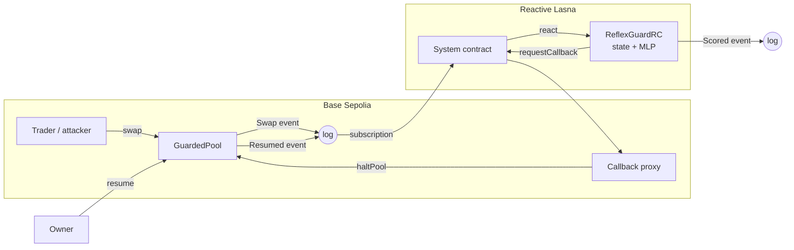

# ReflexGuard

A Reactive Contract that scores every swap of an AMM pool with a small neural network and pauses the pool
when the score crosses a threshold.

- The network is a 6 -> 8 -> 1 MLP with int16 weights, evaluated inside `react()` in integer arithmetic. No oracle, keeper or operator key is in the path.
- Inputs are six features built from the swap log and a rolling state kept in the contract (decayed flow, volume, swap rate, price and reserve EMAs).
- When the score reaches the threshold, the contract sends a cross-chain callback that calls `haltPool` on the pool. Swaps revert until the owner resumes.
- The model is trained offline in numpy on simulated order flow. A Python integer implementation mirrors the Solidity bit for bit, and a Foundry test checks that the scores are identical.
- Built for the Reactive Omni Buildathon, track "Reactive Meets AI". Origin and destination chain: Base Sepolia. Reactive Contract: Lasna.

## Architecture



## The loop

1. A swap on `GuardedPool` emits `Swap(sender, zeroForOne, amountIn, amountOut, reserve0, reserve1, timestamp)` with post-swap reserves.
2. The system contract calls `ReflexGuardRC.react(log)`. The RC decays its rolling state by the time since the previous swap (event timestamps; blocks are 200 ms), derives six features and runs the MLP.
3. The RC emits `Scored(pool, score, features, txHash, timestamp)` for every swap. Score is 0..10000.
4. If `score >= threshold` and no halt is pending, it requests a callback: `haltPool(rc, score, txHash)` on the pool, 200,000 gas.
5. The callback proxy calls the pool. `haltPool` checks the caller is the proxy and that the injected sender is the RC; it sets `paused` and emits `Halted`. The next `swap` reverts with `PoolPaused`.
6. The owner calls `resume()`. The pool emits `Resumed`; the RC clears its state and halt marker.

The 65 weights are constructor arguments stored as five `uint256` immutables in the RC's code (cheaper to read than storage; they cannot be changed after deployment).

The guard reacts to the *unwinding* of a position (the dump, the sandwich back-run, the drip reversal). The opening leg of such an attack looks like a whale swap and is not flagged. See Limits.

## Layout

| path | content |
|---|---|
| `src/origin/` | `GuardedPool` (CPMM, pausable, callback target), `MockToken` |
| `src/reactive/ReflexGuardRC.sol` | state update, features, MLP, callback request |
| `src/reactive/ReflexTables.sol` | generated decay and sigmoid tables |
| `ml/` | simulator, integer reference, numpy training, report, test vectors |
| `test/` | Foundry tests (parity, end-to-end, auth, robustness, gas) |
| `script/`, `scripts/deploy.sh` | deployment |
| `scripts/demo.py`, `scripts/watch.py` | live demo with latency table, Scored tail |
| `docs/SPEC.md` | the integer specification both implementations follow |
| `docs/ASSUMPTIONS.md` | what was not verified |

## Setup and tests

```
forge install --no-git foundry-rs/forge-std Reactive-Network/reactive-lib-omni
forge build
forge test -vv
.venv/bin/python -m unittest discover -s ml      # python side (numpy needed only for training)
```

`forge test` runs 19 tests. `ParityTest` replays 46 event sequences (1,287 swaps, including clipping and
timing edge cases) from `ml/vectors.json` through `react()` and requires the same score and the same packed
features as the Python reference, for every swap. `GuardTest` drives the real pool: a benign flow with a whale
swap does not trigger, a pump-and-dump does, the callback payload is checked, executed as the proxy, the pool
pauses and the next swap reverts; authorisation, resume, retry, malformed logs and gas are covered.

Measured `react()` gas (Foundry `lastFrameGas` of the `react` call, stub system contract, swaps that do not
request a callback): mean 94k and maximum 128k over the 1,266 swaps of the parity vectors (the first swap, which
initialises the state slots, costs about 129k); limit 900k. This includes the `Scored` event and excludes the
system contract's own work and the callback request.

## Retrain

```
python3 -m venv .venv && .venv/bin/pip install numpy
.venv/bin/python ml/train.py          # about a minute; deterministic (seed 7)
.venv/bin/python ml/gen_tables.py     # only if DECAY / SIGMOID in ml/features.py change
forge test
```

`train.py` writes `ml/weights.json` (integer weights, packed words, threshold), `ml/report.md`,
`ml/vectors.json` and `ml/demo_plan.json`. If you change the simulator, features or model, redeploy: weights
are immutable in the RC.

## Deploy and run the demo

```
export PRIVATE_KEY=0x...  BASE_SEPOLIA_RPC=https://...  LASNA_RPC=https://lasna-rpc.rnk.dev/
scripts/deploy.sh                    # tokens + pool on Base Sepolia, RC on Lasna, writes deployments.json
python3 scripts/demo.py --dry-run    # plan and expected scores, no network
python3 scripts/demo.py              # live run, writes docs/RUN.md
python3 scripts/watch.py             # tail Scored events
```

Deployment order matters: the pool takes the RC address in its constructor (immutable callback sender) and the
RC takes the pool address, so the pool address is predicted from the deployer nonce and checked afterwards.

### Deployed addresses

| contract | network | address |
|---|---|---|
| MockToken 0 | Base Sepolia (84532) | _to fill_ |
| MockToken 1 | Base Sepolia (84532) | _to fill_ |
| GuardedPool | Base Sepolia (84532) | _to fill_ |
| ReflexGuardRC | Reactive Lasna (5318007) | _to fill_ |
| Callback proxy (existing) | Base Sepolia | `0xa6eA49Ed671B8a4dfCDd34E36b7a75Ac79B8A5a6` |

## Results

Synthetic data only (`ml/sim.py`: retail, whale, arbitrage and burst regimes; attack families A pump-and-dump,
B sandwich, C slow drip). Integer model as deployed, threshold 8300 of 10000. Full tables, confusion matrices
and failure breakdown in `ml/report.md`.

| measure (test split, 560 benign and 100 scenarios per family) | value |
|---|---|
| per-swap ROC AUC | 0.9993 |
| per-swap precision / recall at threshold | 95.9% / 81.3% |
| per-swap false-positive rate | 0.045% (17 of 37,778 negative-labelled swaps; 16 of 33,721 in benign scenarios) |
| benign scenarios with at least one false halt | 2.9% (burst regime 14 of 140, whale 2 of 140) |
| attacks halted during the unwind: A / B / C | 85% / 86% / 95% |
| float vs integer model, same decision at threshold | 100% of swaps; mean score difference 0.9 of 10000 |

Generalisation, family C held out (trained on benign + A + B, threshold 7250):

| measure | value |
|---|---|
| C scenarios halted during the unwind (n = 500) | 97.4% (95% CI 96-98%) |
| C per-swap recall on unwinding legs | 87.5% |
| C flagged before the unwind starts | 0.0% |
| same model on seen families, test split: A / B caught | 87% / 89% |

## Limits

- **Synthetic data.** Every number above comes from a simulator whose parameters were chosen by the authors. Real flow, real arbitrage bots and real attackers will differ, and the false-halt rate on a real pool is unknown.
- **Small model, narrow features.** Six features and 8 hidden units. The held-out family shares the unwinding signature with the training families; the result shows the model does not depend on a single large opening swap, not that it handles unseen attack mechanisms.
- **It reacts to the unwind, not the opening.** The pump, the front-run and the drip swaps look like a whale or an honest burst. A single-leg unwind completes before the halt lands (the callback needs seconds). The halt stops repeat cycles and multi-leg unwinds.
- **Evasion.** The weights are public. An attacker who knows them can shape trade sizes and timing to stay under the threshold, for example by splitting the unwind across slow, small swaps.
- **Pausing is blunt.** A halt stops all trading, including honest users, until the owner resumes. There is no partial response such as a fee increase or a size cap.
- **False positives pause a legitimate pool.** About 3% of simulated benign scenarios contained a flagged swap, mostly honest bursts with direction reversals. In production the owner resumes manually; the threshold is owner-adjustable within 3000..9990.
- **Fast arbitrage is untested.** A whale swap arbitraged back within seconds looks like a pump-and-dump.
- **Not deployed or audited.** See `docs/ASSUMPTIONS.md` for behaviour of the Reactive Network that was assumed rather than tested.

## Credits and licence

ReflexGuard is MIT licensed (`LICENSE`).

- [reactive-lib-omni](https://github.com/Reactive-Network/reactive-lib-omni) by Reactive Network: `AbstractReactive`, `AbstractCallback`, `AbstractPayer` and interfaces. Its source files are marked `SPDX-License-Identifier: UNLICENSED` and the repository ships no licence file; it is installed as a dependency, not redistributed here.
- [forge-std](https://github.com/foundry-rs/forge-std) by Foundry (MIT / Apache-2.0): test and script helpers.
